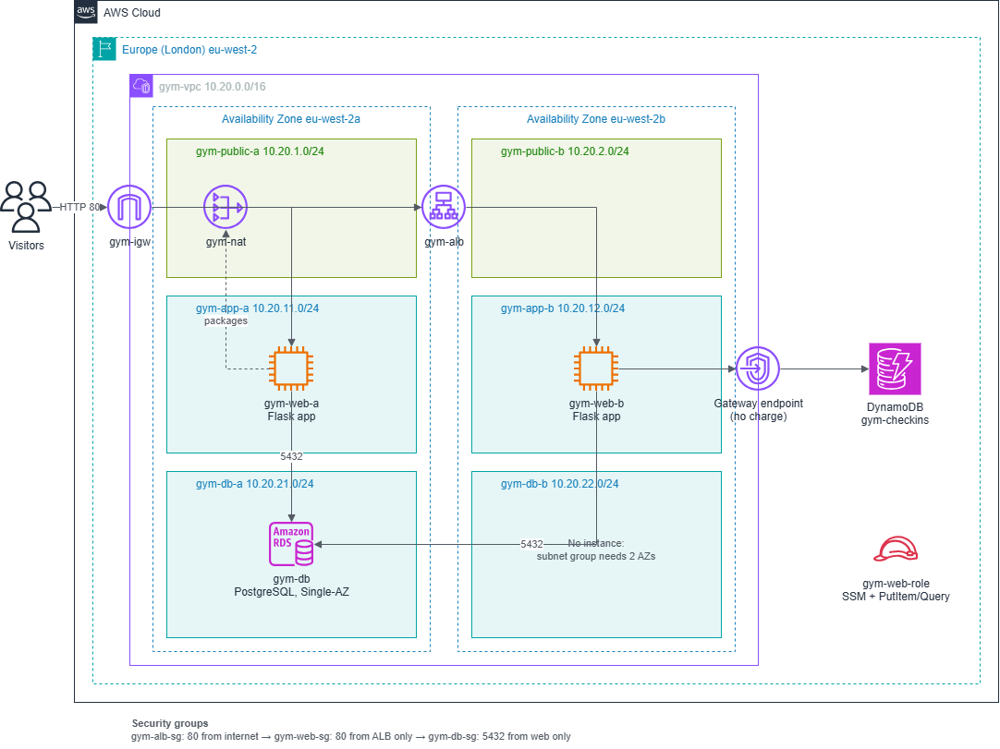
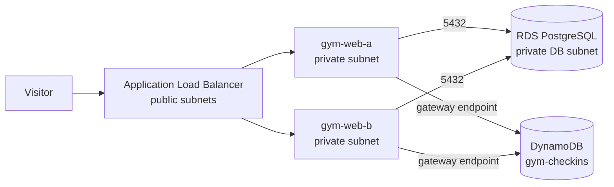

# Northside Gym member portal on AWS (RDS and DynamoDB)

A gym website where members register, log in and see a profile page loaded from **Amazon RDS for PostgreSQL**. A **Check in** button logs their gym visits to **Amazon DynamoDB**. It runs on two private EC2 web servers behind an Application Load Balancer in `eu-west-2`.

> **Status:** in progress · **Mock data only:** the site is HTTP, so it is used only with made-up accounts.

## Why two databases

| Data | Database | Reason |
| --- | --- | --- |
| Members, plans, logins | RDS for PostgreSQL | Unique emails, a join between members and plans, transactions |
| Gym check-ins | DynamoDB | Many small writes, always read as "this member's latest visits" |

## Architecture

- **Network:** one VPC, three subnet tiers (public, app, database) across two Availability Zones, and one NAT Gateway for package downloads.
- **App:** Python (Flask) under gunicorn and systemd, with Apache in front on port 80.

## Security

- Web servers and the database have no public IPs. Each security group allows only the layer in front of it.
- Access to the servers is through **Session Manager**: no SSH keys, no bastion, no port 22.
- The app logs in to the database as `gym_app`, which can only read plans and read or add members.
- Passwords are stored as hashes (scrypt). Settings and secrets live only in `/etc/gym-app.env` on each server, never in Git.
- The instance role can only `PutItem` and `Query` on one DynamoDB table. Traffic to DynamoDB goes through a VPC gateway endpoint.

## Tests

Eleven tests cover registration, dynamic data, login, hashing, least privilege, load balancing, failure of one server and DynamoDB. Results with screenshots are in [docs/test-results.md](docs/test-results.md).

## Build it yourself

Follow [docs/build-guide.md](docs/build-guide.md) from top to bottom. It starts from an empty account and ends with teardown.

## Cost

RDS (`db.t4g.micro`, Single-AZ) and DynamoDB (5 RCU and 5 WCU) fit the AWS Free Tier. The NAT Gateway, load balancer and public IPv4 addresses cost about $0.13 an hour while they run, so the stack is torn down after each session.

## What I learned

See [docs/lessons-learned.md](docs/lessons-learned.md).

## Roadmap

- HTTPS with an ACM certificate, CloudFront, WAF and a Route 53 domain
- Database password in AWS Secrets Manager instead of an environment file
- Aurora PostgreSQL once one database instance is no longer enough
- Rebuild the infrastructure with Terraform

## Author

[Your name] · [LinkedIn link]
